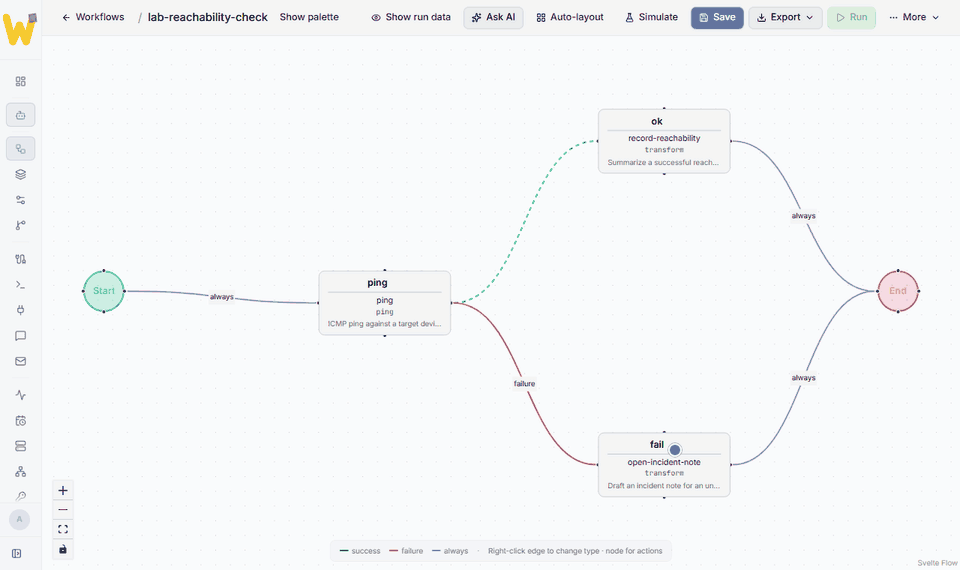
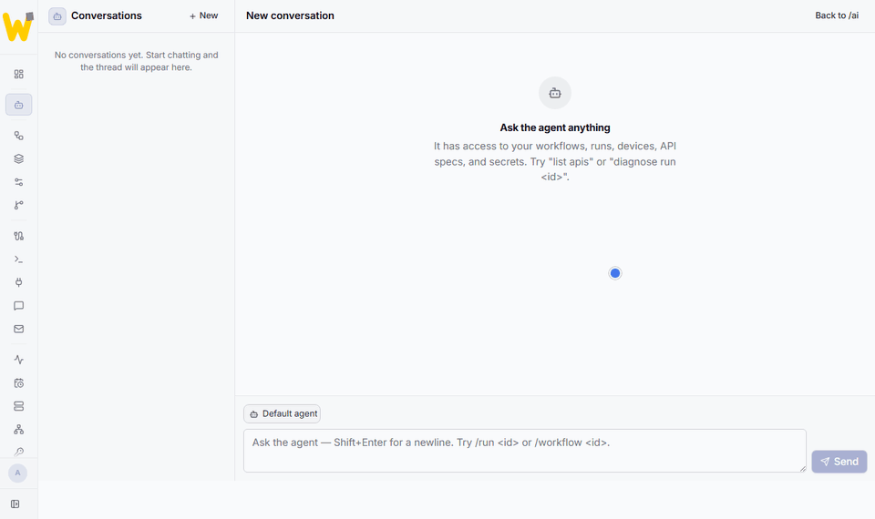
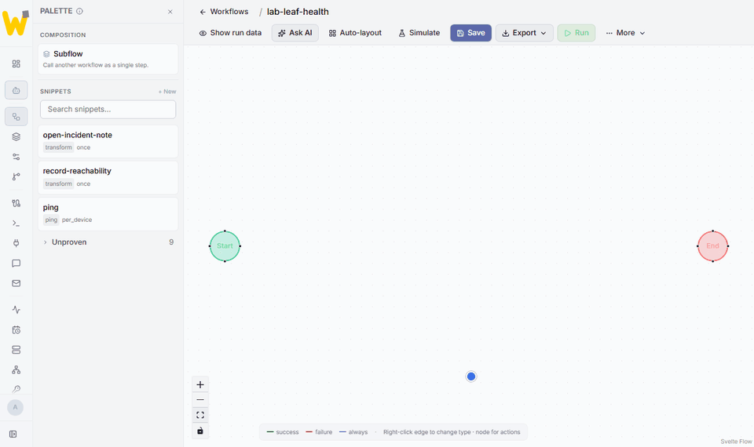
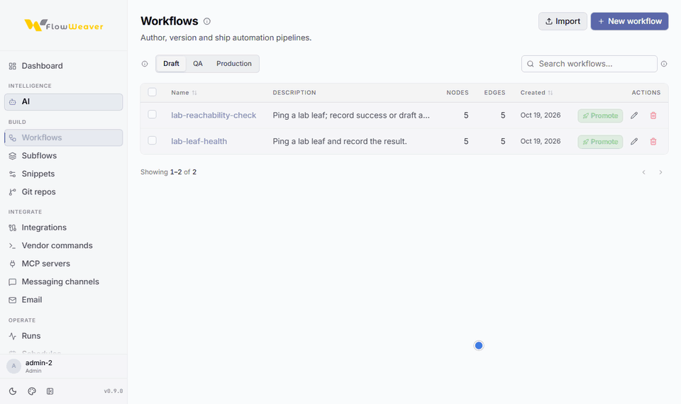
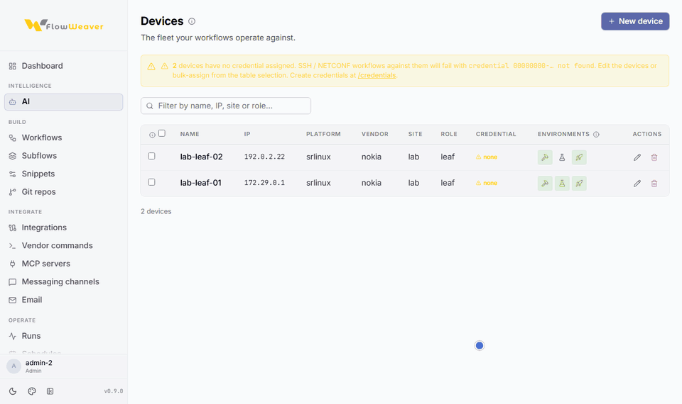

# FlowWeaver

 

**Build network workflows without writing code. Keep control of what runs.**

FlowWeaver is an open-source, self-hosted platform for network automation. Describe a task to the AI assistant or build it in the visual editor, inspect the resulting workflow, and run it through a deterministic execution engine. The platform brings device inventory, multi-vendor integrations, environment controls, simulation, approvals, run logs, and audit records into one place.

The AI helps author workflows; it does not bypass review or execute arbitrary production changes on its own. A workflow still needs the right targets, configuration, permissions, and validation for the environment where it will run.

**Status:** pre-1.0 development release. Interfaces and setup details may change. The active development branch is not a supported production release; see [versioning and support](./CHANGELOG.md#versioning-and-support).

## Get started

1. Follow the [quick start](./QUICK_START_GUIDE.md) to deploy a local instance and create a draft workflow.
2. Use the [first workflow guide](./QUICK_START_GUIDE.md#4-your-first-workflow) for both the AI-assisted and visual-editor paths.
3. Read the [deployment guide](./deploy/README.md) before using a shared or externally reachable instance.

The quick start uses a synthetic lab example. Register only devices you are authorized to manage, and review a workflow before running it against any target.

## What is in the repository

| Area | Location |
|---|---|
| Visual builder and in-app manual | [`frontend/`](./frontend/README.md) |
| API and execution engine | [`flow_weaver_backend/`](./flow_weaver_backend/README.md) |
| Deployment scripts and configuration | [`deploy/`](./deploy/README.md) |
| Product, operator, and architecture docs | [`docs/`](./docs/README.md) |
| Integration and vendor specifications | [`specs/`](./specs/README.md) |
| Versioned workflow contract and conformance suite | [`contracts/`](./contracts/README.md), [`conformance/`](./conformance/) |
| Example and reusable workflow directories | [`examples/`](./examples/README.md), [`workflows/`](./workflows/README.md) |

The `examples/` and `workflows/` directories currently contain guidance rather than a published workflow library. The workflows shown in launch material are product screenshots, not downloadable examples in these directories.

## How the workflow lifecycle works

The first workflow in the quick start starts in **draft**. You can simulate the graph without contacting devices, then run it against targets allowed for that environment. Promotion to **QA** and **production** is governed by environment and approval checks. Production promotion requires a recent successful QA run and an approval step. See the [in-app workflow manual](./frontend/src/routes/docs/workflows/+page.svelte) and [QA lab guide](./frontend/src/routes/docs/qa-lab/+page.svelte) for the current UI behavior.

Permissions include the default Admin, Operator, and Viewer roles. Granular capability grants are available through an opt-in rollout setting and are not the default. See [permissions](./docs/permissions.md) for enforcement scope and current limitations.

## See it in action

The recordings below come from a local demo instance with synthetic lab devices.

**Ask the AI assistant to build a workflow.** The assistant inspects the existing snippets and devices, proposes a plan with the DAG it intends to create, and waits for confirmation. After "yes" it creates the draft workflow, simulates it, and reports what it reused. The result opens in the visual editor like any other workflow. Waiting time for the model is sped up in the recording.

**Build a workflow in the visual editor.** Drag snippets from the palette, connect them, mark the failure branch, save, and simulate without contacting any device.

**Promote through QA to production.** Promotion to QA is refused until the workflow has a passing simulation. Promotion to production is refused until the QA copy has a recent successful run, and it needs a second approver.

**Inventory, run history, and audit.** Register a device and allow it as a QA target, open a run to inspect each step's output, and find the change in the audit log.

## Community and project policies

- [Documentation index](./docs/README.md) and [support routes](./SUPPORT.md)
- [Contributing](./CONTRIBUTING.md), [security reporting](./SECURITY.md), and [governance](./GOVERNANCE.md)
- [Apache License 2.0](./LICENSE), [third-party notices](./THIRD-PARTY-NOTICES.md), and [trademark policy](./TRADEMARK.md)

FlowWeaver is owned and stewarded by **Isaza Labs LLC**. First-party code and documentation are licensed under Apache 2.0; third-party components retain their respective licenses. The Apache license does not grant general rights to use the FlowWeaver name or logo.
