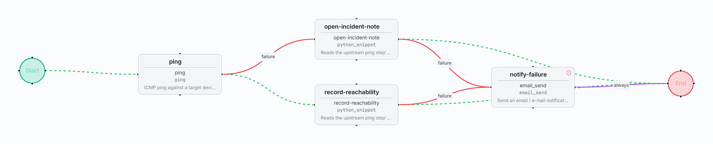

# First workflow: reachability check

A small workflow to import on a new instance. It pings a device. If the device answers,
it records the result. If not, it writes a draft incident note. Use it to learn the
import, simulate and run cycle before you write your own workflows.

| | |
| --- | --- |
| File | [`leaf-reachability-check.bundle.json`](leaf-reachability-check.bundle.json) |
| Format | FlowWeaver workflow bundle, schema `v3`, as written by **Workflows → Export** |
| Source | The validated sample in [`workflows/leaf-reachability-check`](../../workflows/leaf-reachability-check/README.md), with source-instance device names removed from its description |
| Exported from | A FlowWeaver build of the 0.9.0 line, on 2026-10-23 (`exported_at`). That build reported `exported_by.version` as `1.0.0` because the backend did not declare a version until 0.9.0. |
| Imports on | FlowWeaver 0.9.0 and later builds that read bundle schema `v3` |
| Risk | Low. ICMP only; the two Python snippets run offline and only reshape data. |

## What it does

| Step | Type | What it does |
| --- | --- | --- |
| `ping` | `ping` | ICMP ping against the run's target device |
| `record-reachability` | `python_snippet` | Runs on ping success. Outputs device name, IP, `reachable`, average RTT and a UTC timestamp |
| `open-incident-note` | `python_snippet` | Runs on ping failure. Writes a plain-text note marked `[DRAFT - NOT A TICKET]` with the device, IP, detection time and a suggested first check. It never contacts a ticketing system. |
| `notify-failure` | `email_send` | Runs only if one of the two snippets itself fails. Emails the run owner (`{{ run.owner_email }}`). |

## What you need

- A running instance. The [quick start](../../QUICK_START_GUIDE.md) covers installation.
- One device you are authorized to test, registered at `/devices`. It needs a name, a
  management IP and its **draft** environment flag. FlowWeaver must be able to send it
  ICMP.
- A working Python sandbox for the two `python_snippet` steps. With Docker on Linux,
  `run.sh` checks the sandbox after start-up. If the host restricts user namespaces, see
  "When it does not come up" in the quick start.
- Optional: an SMTP relay, used only by `notify-failure`. The reachable and unreachable
  paths never send email.

No AI provider, integration, credential or secret is needed. The bundle contains all
four snippets it uses.

## Import it

1. Download [`leaf-reachability-check.bundle.json`](leaf-reachability-check.bundle.json).
2. In FlowWeaver, open **Workflows → Import** and choose the file.
3. Confirm the import. The workflow lands in **Draft**, whatever environment it was
   exported from.

The bundle names no devices: you choose the target when you run it. Snippet ids from
the source instance are remapped to the ones created on yours.

## What to adapt

Nothing is required. You can optionally adjust:

- `notify-failure` → `to`: defaults to the run owner's email. Set an address if your
  account has none.
- `open-incident-note` → `config_overrides.first_check_hint`: changes the suggested
  first check in the note.
- `config_overrides.ping_node_id` on both snippets: keep it at `ping` unless you rename
  the ping node.

## Simulate it

Open the workflow and select **Simulate**. Simulation checks the graph structure and
the node configuration without contacting any device. A passing
simulation shows the workflow is well formed. It does **not** show that the device is
reachable or that ICMP is allowed from your instance: only a run tests that.

## Run it

Run it only against a device you are authorized to test.

1. Select **Run** and pick **one** target device. The dialog only offers devices enabled
   for the workflow's environment.
2. Open the run in the run monitor.

Use one device per run. With several targets, the engine aggregates the `ping` status
across them. If one device fails, the whole node counts as failed, and only the failure
branch runs, for every device.

## What you should see

- **Device reachable:** the run completes through `record-reachability`. Its output has
  `device_name`, `ip_address`, `status: reachable`, `rtt_avg_ms` and `checked_at`.
- **Device unreachable:** the run also completes, through `open-incident-note`. Its
  `note_text` starts with `[DRAFT - NOT A TICKET - no incident was opened]`.

In both cases `notify-failure` does not run.

## When something fails

- Open the failed step in the run monitor and read its logs, input and output. If an AI
  provider is configured, **Fix with AI** is available there.
- The snippets fail on purpose, with a message that says so, if they are wired to the
  wrong branch or if the upstream node is not called `ping`.
- A `python_snippet` step that fails before the code runs usually points to the sandbox.
  See the `bwrap` row in "When it does not come up" in the
  [quick start](../../QUICK_START_GUIDE.md).
- Backend logs: run `bash ./run.sh logs backend` from `deploy/`.
- Still stuck? See [SUPPORT.md](../../SUPPORT.md) for where to ask and what to include.

First-party content in this directory is licensed under the root Apache 2.0 license.
