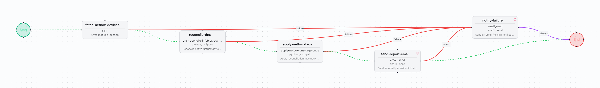

# DNS Audit: NetBox vs. Infoblox

Checks every active NetBox device against Infoblox DNS host records, tags each device
`dns-verified` or `missing-dns` in NetBox, and emails a timestamped CSV report. A failure in
any step sends a notification email instead.

| | |
| --- | --- |
| File | [`dns-audit-netbox-infoblox.bundle.json`](dns-audit-netbox-infoblox.bundle.json) |
| Format | FlowWeaver workflow bundle, schema `v3` (full export: workflow, snippets and dependency identities) |
| Exported from | FlowWeaver, environment `draft` |
| Supported versions | FlowWeaver builds that import bundle schema `v3` |
| Risk level | Medium: writes tags to NetBox devices. Read-only against Infoblox. |

## Flow

| Step | Type | What it does |
| --- | --- | --- |
| `fetch-netbox-devices` | `integration_action` (`netbox:dcim_devices_list`) | Lists active devices, up to 1000 |
| `reconcile-dns` | `python_snippet` `dns-reconcile-infoblox-csv-once` | Looks up `record:host?name=<device>` in Infoblox for each device. A non-empty list is `In Sync`, an empty list is `Missing DNS`. An HTTP error, invalid JSON or a response that is not a list fails the step with the device name and HTTP status. Builds the CSV payload. |
| `apply-netbox-tags` | `python_snippet` `apply-netbox-dns-tags-once` | Adds the target tag, removes the opposite DNS tag and keeps all other tags. Skips the PATCH when the tag set is unchanged. |
| `send-report-email` | `email_send` | Emails the CSV report |
| `notify-failure` | `email_send` | Reached from any failed step: names the run, the failed step and the error |

## Prerequisites

- A NetBox integration with slug `netbox` and an Infoblox integration, each with its spec
  and skill from the skills-specs catalog.
- An SMTP relay configured under *Email*.
- Network access enabled on both python snippets (they call NetBox and Infoblox).

## Inputs

None. The device filter (`status=active`, `limit=1000`) is set on `fetch-netbox-devices`.

## Outputs

- NetBox device tags `dns-verified` / `missing-dns`.
- Email with the CSV report: device, primary IP, DNS status.

## Import

*Workflows → Import*, pick the bundle. The importer resolves the `netbox` integration by
slug. After import:

1. Set `infoblox_integration_id` on `reconcile-dns` and `netbox_integration_id` on
   `apply-netbox-tags` to the integrations of your instance.
2. Replace `netops@example.com` on both email steps.
3. Run **Simulate** before the first run.

## QA evidence

Two runs in `draft` completed in about 35 s: 32 active devices reviewed, CSV emailed. The
second run followed an *Edit with AI* change to `reconcile-dns` that turns Infoblox errors
into step failures instead of silent `Missing DNS` rows.
