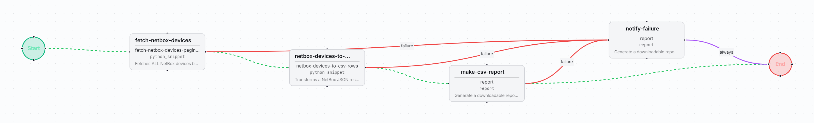

# NetBox devices CSV export

Fetches every NetBox device, following pagination, and exports them as a downloadable CSV
report with one row per device.

| | |
| --- | --- |
| File | [`netbox-devices-csv-export.bundle.json`](netbox-devices-csv-export.bundle.json) |
| Format | FlowWeaver workflow bundle, schema `v3` (full export: workflow, snippets and dependency identities) |
| Exported from | FlowWeaver, environment `production` |
| Supported versions | FlowWeaver builds that import bundle schema `v3` |
| Risk level | Low: read-only against NetBox. |

## Flow

| Step | Type | What it does |
| --- | --- | --- |
| `fetch-netbox-devices` | `python_snippet` `fetch-netbox-devices-paginated` | Calls `GET /api/dcim/devices` page by page (offset-based) until it has NetBox's full `count`, whatever page size the server enforces. Logs a warning on a count mismatch. |
| `netbox-devices-to-csv-rows` | `python_snippet` `netbox-devices-to-csv-rows` | Maps each device to `name, ip, site, role, platform, status`. Neutralises template markers (`{{ }}`) found in NetBox free-text fields. |
| `make-csv-report` | `report` | Builds the CSV file |
| `notify-failure` | `report` | Reached from any failed step: a one-row CSV with the error |

## Prerequisites

- A NetBox integration (spec and skill from the skills-specs catalog).
- Network access enabled on `fetch-netbox-devices-paginated`.

## Inputs

None. `page_limit` (1000) and an optional `query` filter are set on `fetch-netbox-devices`.

## Outputs

A CSV report, downloadable from the run, with columns `name, ip, site, role, platform, status`.

## Import

*Workflows → Import*, pick the bundle. After import, set `netbox_integration_id` on
`fetch-netbox-devices` to the NetBox integration of your instance, then run **Simulate**.
The workflow lands as a draft; promote it to QA and Production as usual.

## QA evidence

Promoted draft → QA → Production with an approver. Production run completed: 517 devices
in the CSV. Fixes made with AI on the way: pagination (the first version stopped at 50
devices), `changes: false` on the transform step, and template markers in device comments.
