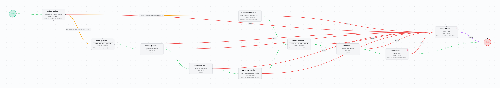

# Silent packet loss check

Diagnoses traffic lost between two devices when both ports look healthy. Resolves the far
end of the cable in NetBox, pulls 5 minutes of Prometheus telemetry for both ends through
the Grafana MCP server, applies fixed verdict rules, annotates the silent-loss dashboard
and emails the verdict. Read-only against the network: no SSH or configuration steps.

| | |
| --- | --- |
| File | [`silent-packet-loss-check.bundle.json`](silent-packet-loss-check.bundle.json) |
| Format | FlowWeaver workflow bundle, schema `v3` (full export: workflow, snippets and dependency identities) |
| Exported from | FlowWeaver, environment `production` |
| Supported versions | FlowWeaver builds that import bundle schema `v3` |
| Risk level | Low: reads NetBox and Prometheus. Its only write is a Grafana annotation. |

## Flow

| Step | Type | What it does |
| --- | --- | --- |
| `netbox-lookup` | `python_snippet` `silent-loss-netbox-lookup` | Reads the interface in NetBox and its `link_peers` to find the far device and interface |
| `build-queries` | `python_snippet` `silent-loss-build-queries` | When a cable is found: one raw-counter selector per end covering the 6 SR Linux packet and error counters, 5-minute range |
| `cable-missing-verdict` | `python_snippet` `silent-loss-cable-missing-verdict` | When no cable is found: verdict "cable missing in NetBox" |
| `telemetry-near`, `telemetry-far` | `mcp_call` `query_prometheus` on `grafana` | Range queries for each end, chained so the verdict waits for both |
| `compute-verdict` | `python_snippet` `silent-loss-compute-verdict` | Computes rates from the counters and applies the rules: telemetry missing, not enough traffic, errors on one or both ends, or silent packet loss (packets sent that never arrive while both ports report clean counters) |
| `finalize-verdict` | `python_snippet` `silent-loss-finalize-verdict` | Takes whichever verdict branch ran and formats the annotation text and the email body |
| `annotate` | `mcp_call` `create_annotation` on `grafana` | Annotates the silent-loss dashboard |
| `send-email` | `email_send` | Emails the verdict |
| `notify-failure` | `email_send` | Reached from any failed step |

`netbox-lookup` branches with conditional edges on `link_found`.

## Prerequisites

- A NetBox integration with cables modelled between the devices.
- An MCP server named `grafana` exposing `query_prometheus` and `create_annotation`, backed
  by Prometheus with SR Linux interface counters (`source` and `interface_name` labels).
- A Grafana dashboard for the annotation.
- Network access enabled on `silent-loss-netbox-lookup`.
- An SMTP relay.

## Inputs

| Name | Default | Description |
| --- | --- | --- |
| `device` | `srl1` | Near-end device name (NetBox name and Prometheus `source` label) |
| `interface` | `ethernet-1/1` | Near-end interface name (Prometheus `interface_name` label) |

## Outputs

- Verdict with per-direction loss percentage, for example: *silent packet loss:
  srl1/ethernet-1/1 -> srl2/ethernet-1/1 is losing 19.6% of packets with both ports
  reporting clean counters.*
- Grafana annotation on the dashboard and a verdict email.

## Import

*Workflows → Import*, pick the bundle. The importer resolves the `grafana` MCP server by
name. After import, set `netbox_integration_id` on `netbox-lookup`, check the dashboard
arguments on `annotate`, replace `netops@example.com` on both email steps, and run
**Simulate**.

## QA evidence

Promoted draft → QA → Production with an approver. With loss injected on one direction of
srl1 ↔ srl2, the Production run reported 19.6% silent loss on srl1 → srl2, FCS, discards
and output errors at 0 on both ends, and no loss on srl2 → srl1. Four fixes made with AI
in draft before the first complete run: counter rates computed in the snippet instead of
PromQL `rate()`, the MCP response shape, chaining the two telemetry queries, and the parser.
