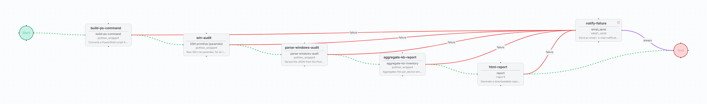

# windows-kb-inventory

Windows patch inventory over SSH with read-only PowerShell: OS, build.UBR, release, dated
hotfixes, latest patch, pending reboot and uptime. Produces an HTML report that lists the
devices requiring attention.

| | |
| --- | --- |
| File | [`windows-kb-inventory.bundle.json`](windows-kb-inventory.bundle.json) |
| Format | FlowWeaver workflow bundle, schema `v3` (full export: workflow, snippets and dependency identities) |
| Exported from | FlowWeaver, environment `draft` |
| Supported versions | FlowWeaver builds that import bundle schema `v3` |
| Risk level | Low: read-only PowerShell queries. The SSH step is marked idempotent and `changes: false`. |

## Flow

| Step | Type | What it does |
| --- | --- | --- |
| `build-ps-command` | `python_snippet` `build-ps-command` | Encodes the collector script as `powershell.exe -EncodedCommand` (UTF-16LE, base64). Fails if the command exceeds 8191 characters. |
| `win-audit` | `python_snippet` `SSH primitive (paramiko)` | Runs the command on each target device over SSH (`mode: exec`) |
| `parse-windows-audit` | `python_snippet` `parse-windows-audit` | Parses the JSON line from stdout: OS fields, hotfixes with dates, last patch date, uptime, and the NVD CPE of the host when the release maps to one |
| `aggregate-kb-report` | `python_snippet` `aggregate-kb-inventory` | Builds inventory rows, hotfix rows and the attention list: last patch older than 35 days or reboot pending |
| `html-report` | `report` | HTML report with counters and tables |
| `notify-failure` | `email_send` | Reached from any failed step |

## Prerequisites

- Windows hosts with OpenSSH Server, registered as devices and selected as run targets.
- A credential named `win-fwaudit` (username and password), ideally a read-only audit
  account. The bundle references it as `${secret:credential:win-fwaudit:...}`; no secret
  travels in the file.
- An SMTP relay for `notify-failure`.

## Inputs

None. The PowerShell collector script is set on `build-ps-command`.

## Outputs

HTML report: per-device OS, build.UBR, release, hotfixes, last patch, pending reboot,
uptime, and the devices requiring attention.

## Import

*Workflows → Import*, pick the bundle. The `SSH primitive (paramiko)` snippet is shared:
if your instance already has it, the import reuses it. After import, create the
`win-fwaudit` credential, replace `netops@example.com` on `notify-failure`, and run
**Simulate**.

Some labels in the HTML report document (for example the counter titles) are in Spanish;
edit `html-report` to change them.

## QA evidence

Imported, adapted with AI (English descriptions, failure notification, idempotent SSH
step, auto-layout) and simulated: *Ready to run*. Not yet run against Windows hosts.
